# Serverless Orders API — AWS Lambda + API Gateway (Java 17)

A small Order Management REST API implemented in Java 17 and exposed through Amazon API Gateway in
**two different architectures**, so their responsibilities and trade-offs can be compared:

* **Architecture A** — API Gateway *mapping templates* (non-proxy integration), one Lambda per operation.
* **Architecture B** — Lambda *proxy integration* with a thin HTTP adapter, one Lambda for the whole API.

> Items marked **TODO (AWS)** depend on observations from the deployed system; fill them in after following
> [docs/AWS_STEP_BY_STEP.md](docs/AWS_STEP_BY_STEP.md).

## Contents

1. [Final architecture](#1-final-architecture)
2. [Build, test and run](#2-build-test-and-run)
3. [API design](#3-api-design)
4. [Part I — Plain Java + Checkpoint 1](#4-part-i--plain-java--checkpoint-1)
5. [Part II — First Lambda + Checkpoint 2](#5-part-ii--first-lambda--checkpoint-2)
6. [Parts III–IV — Architecture A (API Gateway mapping) + Checkpoint 3](#6-parts-iiiiv--architecture-a-api-gateway-mapping--checkpoint-3)
7. [Part V — Architecture B (proxy integration + adapter)](#7-part-v--architecture-b-proxy-integration--adapter)
8. [Comparing the two architectures](#8-comparing-the-two-architectures)
9. [AI-assisted development: criticizing the agent](#9-ai-assisted-development-criticizing-the-agent)
10. [Final challenge — DELETE](#10-final-challenge--delete)
11. [Final API, status codes and unexpected errors](#11-final-api-status-codes-and-unexpected-errors)
12. [Repository layout](#12-repository-layout)

---

## 1. Final architecture

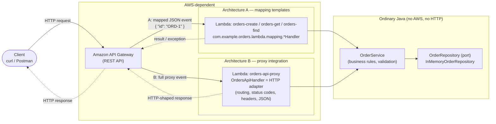

| Component | Depends on AWS? | Knows HTTP? | Code |
|-----------|-----------------|-------------|------|
| API Gateway | yes (managed service) | yes | configuration, `aws/mapping-templates/` |
| Lambda handlers A | yes (`RequestHandler`, `Context`) | **no** | `lambda/mapping/` |
| HTTP adapter B | yes (API Gateway event classes) | **yes** (the only Java class that does) | `lambda/proxy/OrdersApiHandler` |
| `OrderService`, domain, repository | **no** | **no** | `application/`, `domain/`, `infrastructure/` |

Dependencies point inwards only: `lambda` → `application` → `domain`; the core never imports `com.amazonaws`.

---

## 2. Build, test and run

Requirements: JDK 17+ (compiles with `--release 17`), Maven 3.9+.

```bash
mvn test       # 41 unit tests, no AWS needed
mvn package    # produces target/orders-api-1.0.0.jar (fat JAR, deployable to Lambda)
```

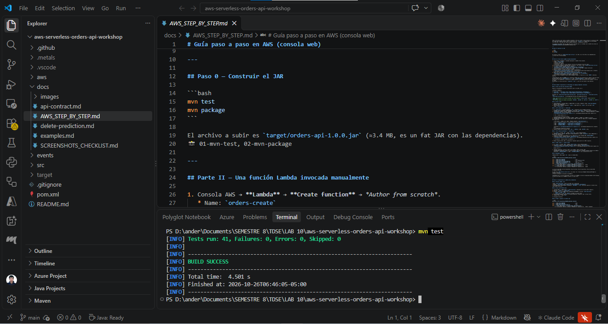
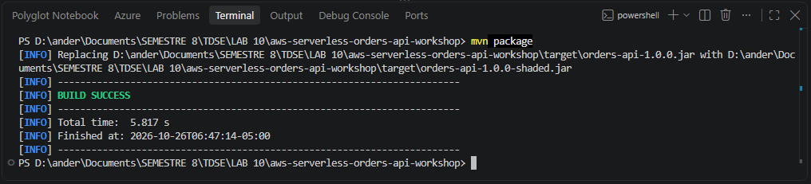

Deployment to AWS (console step by step): [docs/AWS_STEP_BY_STEP.md](docs/AWS_STEP_BY_STEP.md).

Sample payloads: [`events/direct/`](events/direct) (direct Lambda invocation) and
[`events/proxy/`](events/proxy) (API Gateway proxy events). Expected requests/responses: [docs/examples.md](docs/examples.md).

---

## 3. API design

Full contract: [docs/api-contract.md](docs/api-contract.md) (written before any code).

| Operation | Request | Success | Errors |
|-----------|---------|---------|--------|
| Create order | `POST /orders` | `201` + order + `Location` | `400` |
| Get order | `GET /orders/{id}` | `200` + order | `404` |
| Find by customer | `GET /orders?customerId=…` | `200` + array (maybe `[]`) | `400` |
| Delete order | `DELETE /orders/{id}` | `204` | `404` |

**What are the resources in the API?**
`orders` (the collection, `/orders`) and a single `order` (`/orders/{id}`). Verbs are expressed by HTTP methods,
not by the URL (`/getOrder`, `/createOrder` would be RPC-style).

**Why `/orders/{id}` to retrieve a particular order?**
The id *identifies* one specific resource, so it belongs in the path: the URL is the order's address, it can be
bookmarked/cached and it nests naturally under the collection. A missing identified resource is a clean `404`.

**Why is `customerId` a query parameter in the search?**
The search does not identify a single resource, it *filters* the `/orders` collection. Filters are optional,
combinable (`&status=…` later) and do not change what resource is being addressed. `/customers/{id}/orders` would also be
valid REST, but it would introduce a second resource that the workshop does not need.

**What should `POST /orders` return on success?**
`201 Created` with the created order (including the server-generated `id`) in the body and a
`Location: /orders/{id}` header pointing to the new resource. Not `200`: a new resource was created.

**What should the API return when an order does not exist?**
`404 Not Found` with the standard error body. For the *search*, no matches is `200` with `[]`: the collection exists,
it is just empty.

**What information should an error response contain?**
A stable machine-readable `error` code and a human-readable `message` (same JSON shape for every error). It must
not contain stack traces or internal details; for unexpected failures the message is generic and the detail goes to the logs.

```json
{ "error": "ORDER_NOT_FOUND", "message": "Order ORD-999 does not exist" }
```

---

## 4. Part I — Plain Java + Checkpoint 1

Application logic (`domain/`, `application/`, `infrastructure/`) is ordinary Java: `Order`, `CreateOrderRequest`,
`OrderService`, `OrderRepository` (a port) and `InMemoryOrderRepository`. Business rules (validation: non-blank
customer and product, quantity > 0) live in `OrderService`. Tests: `OrderServiceTest` covers creation, retrieval,
non-existent order, search by customer, invalid input and deletion.

Storage is in memory and **not persistent**: a Lambda execution environment is ephemeral, and each function
(and each concurrent environment) has its own copy. Three sample orders are preloaded so reads work everywhere.

**Checkpoint 1**

* *Can the functionality be tested without AWS?* Yes. `OrderServiceTest` only needs JUnit; the handlers can be tested
  by calling them directly with hand-built events/objects.
* *Does it require a web server?* No. Nothing in the project listens on a port; HTTP is provided by API Gateway.
* *Does it require Spring Boot?* No. Plain Java + Maven + Jackson (only in the HTTP adapter).
* *What does the generated JAR contain?* The compiled classes of this project plus, thanks to `maven-shade-plugin`, its
  runtime dependencies (`aws-lambda-java-core`, `aws-lambda-java-events`, Jackson, joda-time) — a *fat JAR*, because Lambda
  does not resolve Maven dependencies. 
* *Which parts know about HTTP?* Only `lambda.proxy.OrdersApiHandler` and `ApiResponses`. `domain`, `application` and
  `infrastructure` have no HTTP or AWS imports (the Architecture A handlers know AWS's `RequestHandler`, but not HTTP).

---

## 5. Part II — First Lambda + Checkpoint 2

`orders-create` runs `com.example.orders.lambda.mapping.CreateOrderHandler::handleRequest` on the Java 17 runtime,
invoked manually from the console with the JSON in [`events/direct/`](events/direct).


**How does the Lambda Java runtime convert JSON to Java objects and back?**

The Lambda Java runtime looks at the type parameters of `RequestHandler<I, O>`: the event JSON is deserialized
into `I` (here `CreateOrderRequest`) and the returned `O` is serialized to JSON. For plain beans it relies on a Jackson-based
serializer bundled in the runtime: it needs a public no-argument constructor and getters/setters (this is why `Order` and
`CreateOrderRequest` are beans, not records). Basic types (`String`, `Map`, `List`, numbers) are handled directly;
`List<Order>` is serialized as a JSON array. If the handler throws, the runtime returns
`{"errorMessage": ..., "errorType": ..., "stackTrace": [...]}` instead.

> **TODO (AWS):** verify against the deployed function and write down what you observed, e.g. the behavior with an unknown
> field, `"quantity": "abc"`, a missing field (primitive `int` becomes `0`), and the shape of the error JSON.

**Checkpoint 2 — actual data flow**

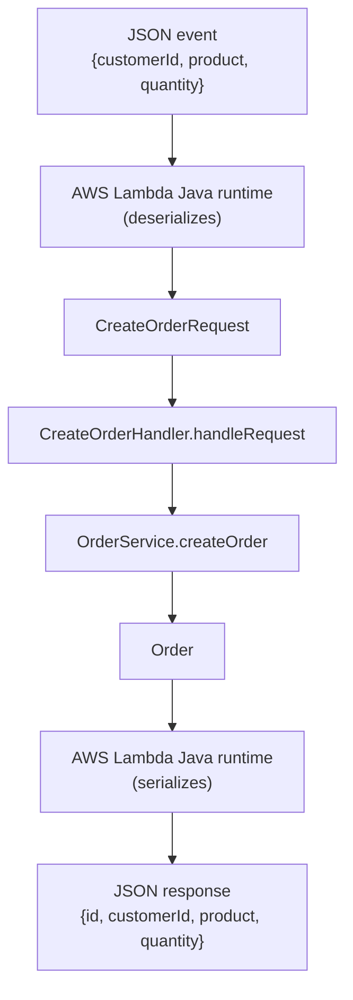

---

## 6. Parts III–IV — Architecture A (API Gateway mapping) + Checkpoint 3

Three Lambdas (`orders-create`, `orders-get`, `orders-find`) behind an API Gateway REST API with
**Lambda proxy integration turned off**:

| Route | Request mapping template | Lambda input |
|-------|-------------------------|--------------|
| `GET /orders/{id}` | `{ "id": "$input.params('id')" }` | `GetOrderInput` |
| `GET /orders?customerId=` | `{ "customerId": "$input.params('customerId')" }` | `FindOrdersInput` |
| `POST /orders` | `$input.json('$')` (body passthrough) | `CreateOrderRequest` |

Status codes are chosen by API Gateway: a Lambda cannot return a status in this mode, so the handlers throw
`MappedApiException` whose message *is* the JSON error body, and integration responses match it by regex:

| Integration response | Selection pattern | HTTP status |
|----------------------|-------------------|-------------|
| default | *(empty)* | `200` (`201` for POST) |
| not found | `.*ORDER_NOT_FOUND.*` | `404` |
| invalid input | `.*INVALID_ORDER.*` | `400` |
| unexpected | `.*INTERNAL_ERROR.*` | `500` |

Templates are in [`aws/mapping-templates/`](aws/mapping-templates). Screenshots:

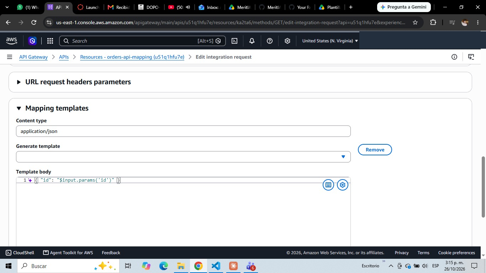
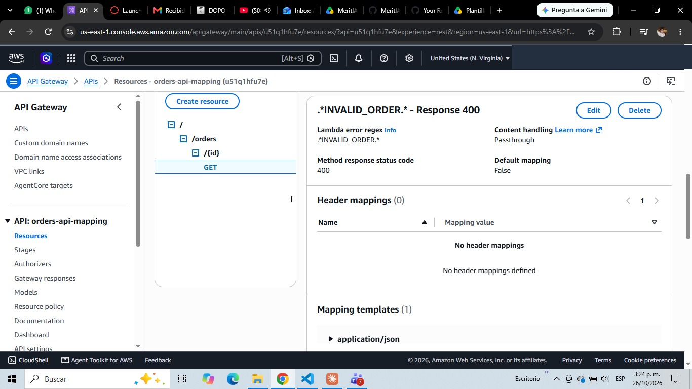
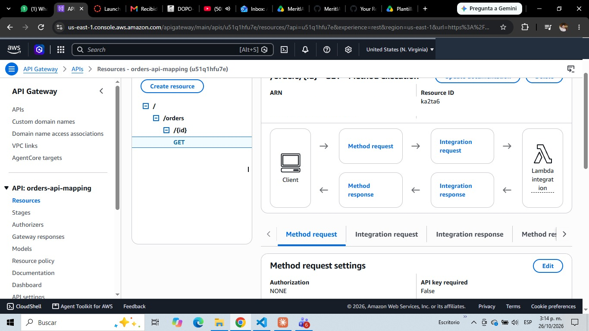
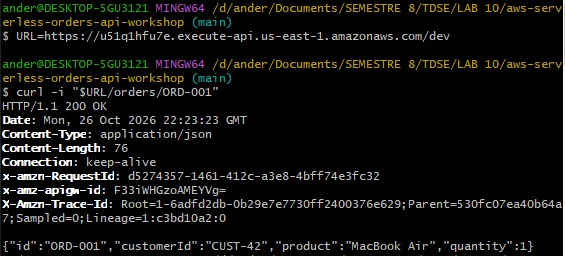
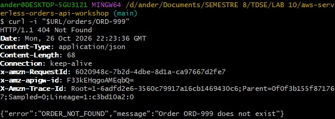

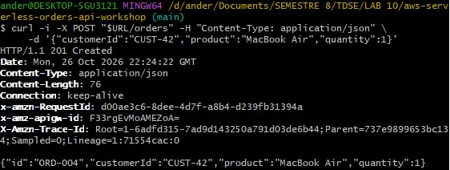
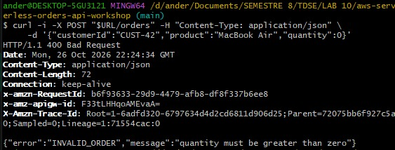

**Checkpoint 3 — what is API Gateway responsible for in Architecture A?**

* routing (method + path → Lambda);
* extracting path parameters (`{id}`) and query parameters;
* transforming the request into the JSON the function expects (mapping templates);
* choosing the HTTP status code (selection patterns on the Lambda error message);
* mapping errors to response bodies (response templates);
* transforming responses (here: passthrough on success).

*Advantages:* the Java code stays tiny and HTTP-free (handlers are plain `Input → Output` functions);
request shape can change without redeploying Java; API Gateway can validate/reject requests before invoking Lambda
(saving invocations); one-function-per-operation scales and deploys independently.

*Disadvantages:* a lot of behavior lives in console configuration in a non-Java language (VTL) that is hard to unit
test locally, version and review; error → status mapping relies on regexes over message text (fragile coupling
between Java and gateway config); no `Location` header without extra header mappings; malformed JSON is
rejected by the gateway template with an unhelpful error unless request models are configured; every new operation
means more clicks (or IaC) in two places.

---

## 7. Part V — Architecture B (proxy integration + adapter)

One Lambda (`orders-api-proxy`) receives the *whole* HTTP request as an `APIGatewayProxyRequestEvent` and must return an
`APIGatewayProxyResponseEvent` (status, headers, body). API Gateway only forwards: no mapping templates, no method/integration response config.

`OrdersApiHandler` is the HTTP adapter. It is the only class that knows API Gateway events: it routes by
`resource` + `httpMethod`, reads path/query parameters and the body, calls `OrderService`, and translates results and
domain exceptions into HTTP (`OrderNotFoundException` → 404, `InvalidOrderException` → 400, anything else → 500).
It also sets `Content-Type` and `Location` (on `201`).

**Where is each piece of information in the proxy event?** (examples: [`events/proxy/`](events/proxy))

| Information | Field |
|-------------|-------|
| HTTP method | `httpMethod` |
| Path | `path` (concrete, `/orders/ORD-001`) and `resource` (template, `/orders/{id}`) |
| Path parameters | `pathParameters` (`{"id": "ORD-001"}`) |
| Query parameters | `queryStringParameters` (and `multiValueQueryStringParameters`) |
| Headers | `headers` (and `multiValueHeaders`) |
| Request body | `body` (a **string**; `isBase64Encoded` tells if it is binary) |

> The files in `events/proxy/` are hand-written following the documented schema. **TODO (AWS):** replace with the real event
> from CloudWatch (set `LOG_EVENT=true` on the function) 

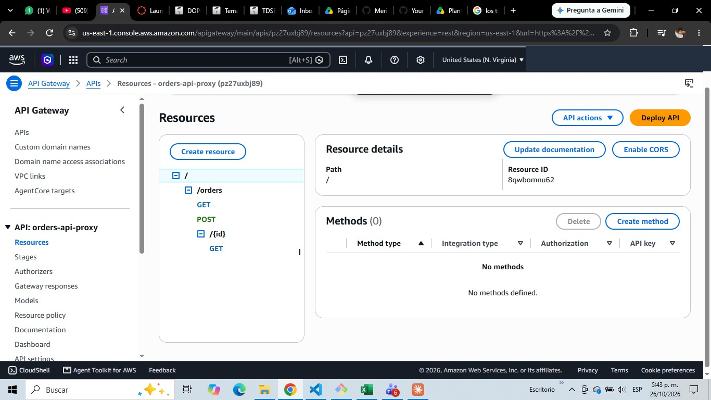
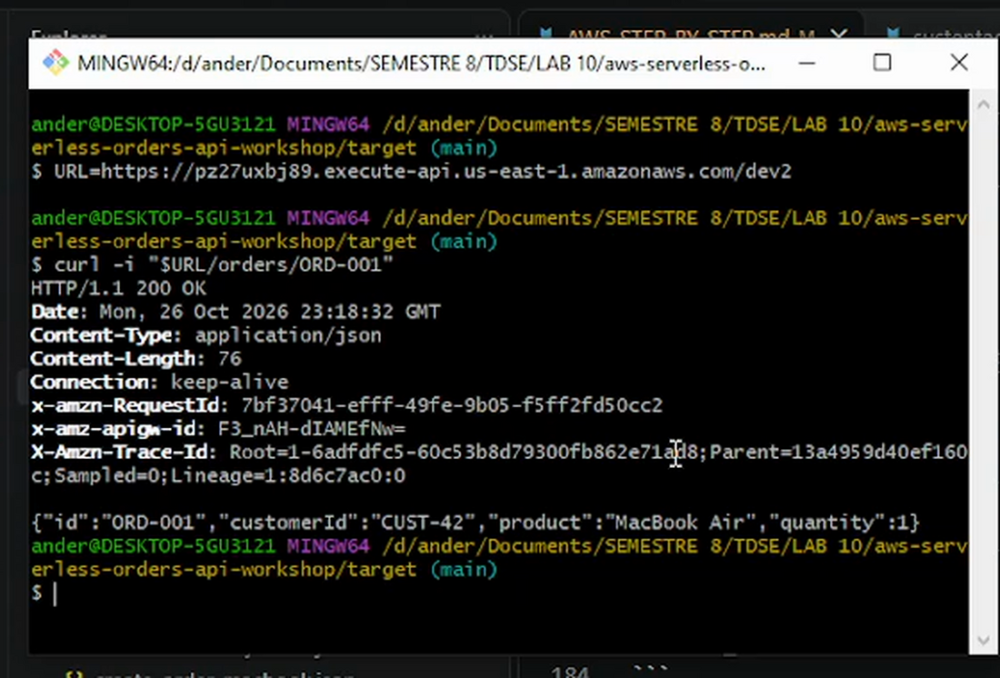
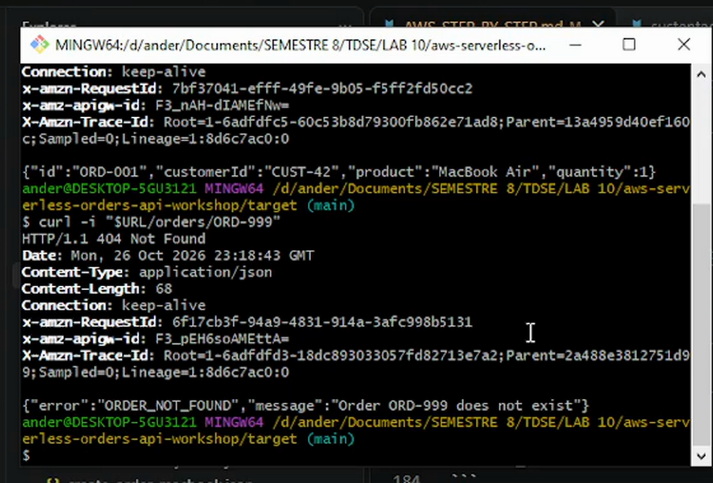


Because the adapter is just a Java class, it is tested locally with hand-built events
(`OrdersApiHandlerTest`, 15 tests): all status codes, `Location`, malformed JSON, unknown routes and a simulated
internal failure that must not leak details.

**Location header:** yes, it is appropriate after `POST`: `201 Created` should tell the client where the new resource
lives. Implemented as a relative reference (`/orders/ORD-004`); behind a stage the client must prepend the stage path.

---

## 8. Comparing the two architectures

| Question | A — mapping templates | B — proxy + adapter |
|----------|----------------------|---------------------|
| **More API Gateway configuration?** | **A**: per method a request template, method responses and integration responses per status code. | B: just resource + method + "proxy on". |
| **More Java infrastructure code?** | B: routing, event parsing, response building (~190 lines in `lambda/proxy`). A needs less, but still needs input classes and the exception translation. | **B** |
| **Easier to test locally?** | **B**: everything (status codes, routing, headers) is Java and tested with `mvn test`. In A the templates and status mapping can only be verified in AWS. | **B** |
| **Where are status codes defined?** | In API Gateway (integration-response regexes). Java only signals a *kind* of error via the message. | In the Java adapter (`OrdersApiHandler`), in code, under version control and tests. |
| **What if the API grows from 3 to 30 operations?** | 30 × (template + responses) of console config, or a big OpenAPI/IaC document; many Lambdas to deploy and keep consistent. Inconsistencies between routes become likely. | Add routes to the adapter (or split into several adapters/Lambdas, e.g. per resource). API Gateway config stays trivial (or `{proxy+}`). The router may need a real framework/library at that size. |
| **Which makes the business logic cleaner?** | Equal in the core: `OrderService` is identical in both. A keeps AWS/HTTP out of the handlers' logic but couples errors to gateway regexes. | Equal in the core; B concentrates all HTTP concerns in one class, so the core is not polluted. |
| **Easier for another developer to understand?** | Harder: behavior is split between Java and console/VTL that does not appear in the repo's code. | Easier: one place to read, debug and step through; standard Java. |
| **Which for a larger system, and why?** | | **B** (proxy + thin adapter, with infrastructure as code such as SAM/CDK/OpenAPI to define routes). Behavior stays in versioned, testable code; the gateway does what it is best at (auth, throttling, TLS, routing, optional request validation). Architecture A is still reasonable for very small, stable integrations or when you must adapt a request for a function you cannot change. |

Key insight: in both architectures `OrderService` is unchanged. The difference is **where HTTP responsibilities live**:
in API Gateway configuration (A) or in a thin, testable Java adapter (B).

---

## 9. AI-assisted development: criticizing the agent

I used Claude Code as an engineering collaborator. The architecture came from the contract I wrote first
([docs/api-contract.md](docs/api-contract.md)); the agent made implementation decisions that I review below.

> **Review these entries and rewrite them in your own words/opinion before submitting.** They describe real decisions
> taken during the session; the "do you agree" parts are an initial assessment you should confirm or change.

### Decision 1 — One Lambda per operation (A) vs. one Lambda for the whole API (B)

* **Decision made by the agent:** Architecture A uses three handlers (`orders-create`, `orders-get`, `orders-find`);
  Architecture B uses a single `OrdersApiHandler` that routes internally.
* **Why it proposed this:** In non-proxy mode each API Gateway method has its own input shape, so one function per
  operation maps naturally to one mapping template. In proxy mode the event already carries method and path, so a
  single entry point can route.
* **Do I agree?** Partly. It is the natural fit for each integration style. But it hides a cost: in A, the functions do
  not share memory, so a created order is invisible to `orders-get`; and a single Lambda in B becomes a "mini monolith" with a
  routing `switch` that grows with the API.
* **Alternative:** a single Lambda also in A (routing on a field in the mapped event), or one Lambda per *resource* in B.
* **What was implemented and why:** the agent's split, because the workshop is precisely about comparing them; the
  data-sharing limitation is mitigated with seeded sample data and documented.

### Decision 2 — Errors in Architecture A travel as an exception whose message is the JSON body

* **Decision made by the agent:** `MappedApiException` carries `{"error":"ORDER_NOT_FOUND","message":"…"}` as its message;
  API Gateway matches `.*ORDER_NOT_FOUND.*` etc. and echoes `$input.path('$.errorMessage')` as the body.
* **Why it proposed this:** a non-proxy Lambda cannot set an HTTP status; the only channel API Gateway can inspect is the
  `errorMessage` of a failed invocation.
* **Do I agree?** It works but it is a hack: the contract (error code ↔ status) is encoded in regexes over a text field
  and is duplicated in Java and in gateway config; renaming a code breaks the mapping silently.
* **Alternative:** return a result envelope `{statusCode, body}` from the Lambda and map on a body field (but that
  puts HTTP concepts in the Lambda, defeating the architecture), or use proxy integration for errors.
* **What was implemented and why:** the agent's approach, with a unit test asserting the exact message format, because it is the
  idiomatic way to do status mapping with non-proxy integration and keeps the handlers free of HTTP concepts.

### Decision 3 — Validation lives in `OrderService`, not in the adapter or the gateway

* **Decision made by the agent:** `OrderService` throws `InvalidOrderException` for blank customer/product and `quantity <= 0`;
  adapters only translate it (`400`). Only the *HTTP-level* validation (missing body, malformed JSON) is in the adapter.
* **Why it proposed this:** validation rules are business rules; if they lived in the adapter or in an API Gateway
  request model they would be bypassed by any other entry point (another adapter, a direct Lambda invocation, tests).
* **Do I agree?** Yes. The rules are tested once in `OrderServiceTest` and hold for both architectures.
* **Alternative:** JSON-schema request validation in API Gateway (rejects early, saves a Lambda invocation) — useful as an
  additional first line of defense, not as the only one.
* **What was implemented and why:** application-level validation, plus adapter-level `INVALID_JSON`, because it keeps one source of truth.

### Decision 4 — Repository as an interface plus an in-memory implementation, shared through a static singleton

* **Decision made by the agent:** `OrderRepository` port, `InMemoryOrderRepository`, and a static `OrdersApplication.service()` reused
  across invocations of a warm environment; handlers also have a constructor taking an `OrderService` for tests.
* **Why it proposed this:** tests can inject their own repository; swapping in DynamoDB later does not touch the service; static
  initialization runs once per cold start (cheaper than rebuilding per invocation).
* **Do I agree?** Mostly. The port is slightly more than the workshop needs (no database), but it is small and made the delete
  prediction trivial to reason about. The static singleton is the questionable part: hidden global state whose lifetime is
  controlled by the platform, which is exactly why the README warns that it is not persistence.
* **Alternative:** a concrete `Map` inside the service (simpler) or dependency injection framework (overkill).
* **What was implemented and why:** the port + in-memory adapter, with the singleton confined to a single composition-root class.

### Decision 5 — Mutable beans instead of Java `record`s for the DTOs

* **Decision made by the agent:** `Order` and `CreateOrderRequest` are classic beans (no-arg constructor + getters/setters).
* **Why it proposed this:** the Lambda runtime's serializer and Jackson are most reliable with beans; records require newer runtime support.
* **Do I agree?** Yes for this project, accepting the loss of immutability for deserialization compatibility.
* **Alternative:** records (immutable, concise) — worth testing on the deployed runtime.
* **What was implemented and why:** beans, to avoid depending on runtime-version-specific record support.

---

## 10. Final challenge — DELETE

The prediction was written and committed **before** implementing: [docs/delete-prediction.md](docs/delete-prediction.md)
(see `git log`: `docs: record DELETE /orders/{id} prediction…` precedes `feat: add delete order operation…`).

**Prediction vs. what was actually needed**

| Question | Prediction | Result |
|----------|-----------|--------|
| Classes to change | `OrderRepository`, `InMemoryOrderRepository`, `OrderService`, `OrdersApiHandler` | Same four, plus one test double (the failing repository in `OrdersApiHandlerTest`) that had to implement the new interface method — I did not predict that. |
| New Lambda? | No | No |
| API Gateway change? | Add `DELETE` on `/orders/{id}` (proxy) and redeploy | Same (in Architecture B only) |
| Where is deletion logic? | `OrderService` (+ repository removes) | Same |
| Where is 204/404 decided? | HTTP adapter | Same: service throws `OrderNotFoundException`; adapter returns `204` or maps to `404` |
| Tests | service + adapter tests | 4 service tests + 3 adapter tests |

**Comparison with the agent's proposal:** *TODO — write what the agent proposed before implementing and how it
differed from your prediction (if you prompted it separately), or note that the agent followed the prediction.*

Demo: 
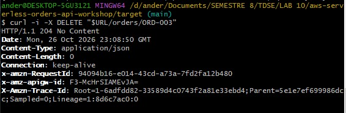
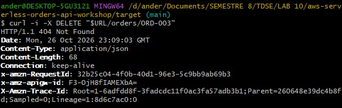

Note that, as an architectural consequence, adding `DELETE` to Architecture A would have required a new Lambda *and* a new
method, mapping template and 3–4 response configurations; in B it was one `case` in a `switch` and one console method.

---

## 11. Final API, status codes and unexpected errors

```
POST    /orders                      201 Created   | 400
GET     /orders/{id}                 200 OK        | 404
GET     /orders?customerId={id}      200 OK        | 400
DELETE  /orders/{id}                 204 No Content| 404
```

| Status | Where demonstrated |
|--------|--------------------|
| 200 OK | `GET /orders/{id}`, `GET /orders?customerId=` |
| 201 Created | `POST /orders` (with `Location`) |
| 204 No Content | `DELETE /orders/{id}` |
| 400 Bad Request | invalid order, missing body/`customerId`, malformed JSON |
| 404 Not Found | unknown order, unknown route |
| 500 Internal Server Error | any unexpected exception |

**Unexpected internal errors.** In Architecture B the adapter catches every `Exception` that is not a known domain error and
returns `500` with `{"error":"INTERNAL_ERROR","message":"Unexpected error"}`; the stack trace goes to CloudWatch, never to the
client (tested by `unexpectedFailureReturns500WithoutLeakingDetails`). In Architecture A the handlers wrap unknown failures in
`INTERNAL_ERROR`, which API Gateway maps to `500`.

**Known limitations:** in-memory state is per execution environment and lost on cold start/redeploy; ids are sequential per
environment (two environments can generate the same `ORD-004`). A real system would use a database (e.g. DynamoDB).

---

## 12. Repository layout

```
.
├── pom.xml
├── README.md
├── aws/mapping-templates/       VTL templates for Architecture A
├── docs/
│   ├── api-contract.md          API design (before coding)
│   ├── delete-prediction.md     final-challenge prediction (committed before the feature)
│   ├── examples.md              example requests/responses
│   ├── AWS_STEP_BY_STEP.md      how to reproduce the deployment
│   ├── SCREENSHOTS_CHECKLIST.md which screenshots to take
│   └── images/                  screenshots used by this README
├── events/
│   ├── direct/                  JSON for manual Lambda invocation
│   └── proxy/                   API Gateway proxy event examples
└── src/
    ├── main/java/com/example/orders/
    │   ├── domain/              Order, CreateOrderRequest, exceptions      (plain Java)
    │   ├── application/         OrderService, OrderRepository              (plain Java)
    │   ├── infrastructure/      InMemoryOrderRepository                    (plain Java)
    │   └── lambda/
    │       ├── OrdersApplication.java   composition root
    │       ├── mapping/         Architecture A handlers                    (AWS)
    │       └── proxy/           Architecture B HTTP adapter                (AWS + HTTP)
    └── test/java/               41 unit tests
```
